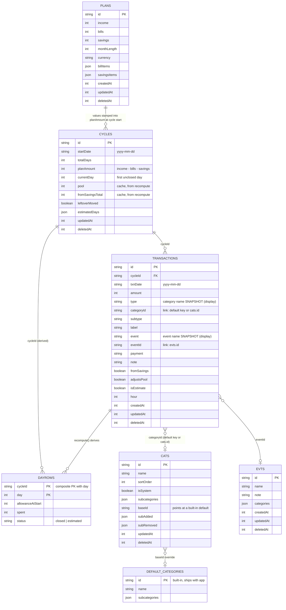
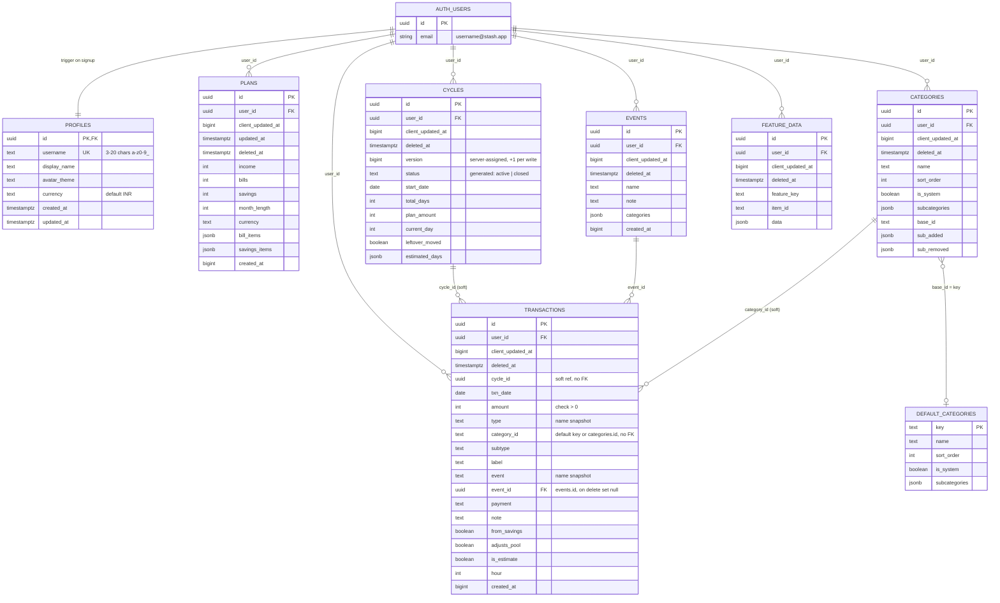
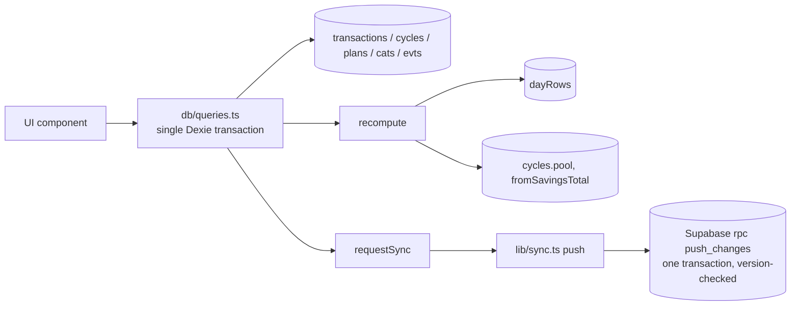
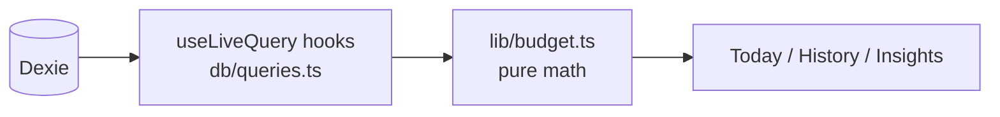
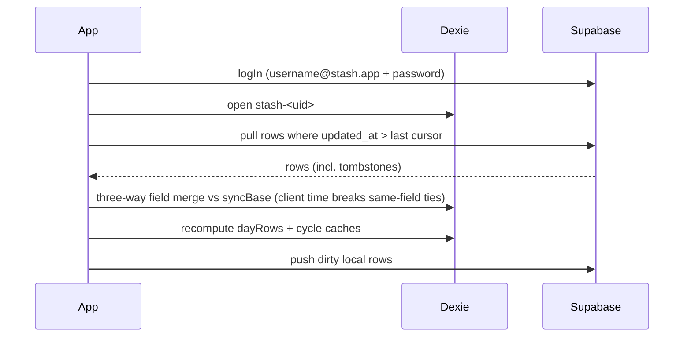
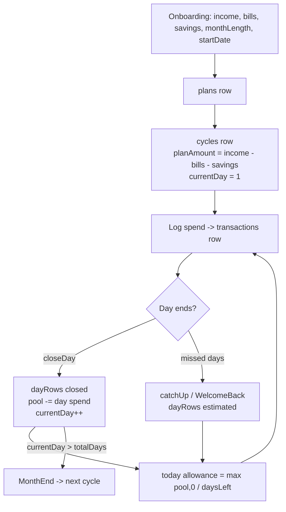
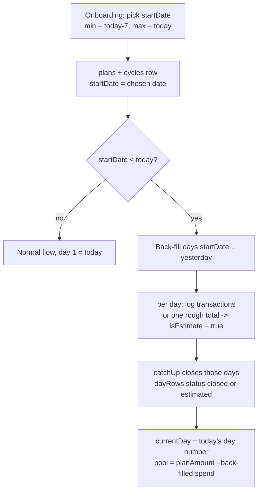

# Stash — Database Tables, Flow & ER Diagram

Two stores hold the same data:

- **Local (Dexie / IndexedDB)** — source of truth on device. One DB per user: `stash-<uid>` (guest = `stash-default`). Schema v9. Defined in `db/schema.ts`.
- **Remote (Supabase Postgres)** — sync target, RLS per `auth.uid()`. Defined in `supabase/schema.sql`.

Paste any `mermaid` block below into https://mermaid.live (or a GitHub / VS Code Mermaid preview) to render it.

---

## 1. ER diagram — local (Dexie)

Relations are logical (IndexedDB has no foreign keys).

Notes
- `DAYROWS` is **derived** from `TRANSACTIONS` by `recompute` and **never synced**. `CYCLES.pool` and `CYCLES.fromSavingsTotal` are caches written by the same step.
- `TRANSACTIONS.categoryId` / `.eventId` link to categories / events **by id**. `type` and `event` are only display snapshots, so a rename never orphans history (see `docs/FINDINGS.md` F-26). Legacy rows without ids fall back to a case-insensitive name match.
- `CATS` only stores rows for user-added categories or overrides of a shared default (`baseId`).
- All synced tables carry `id (uuid)`, `updatedAt` (client ms: dirty tracking and the tiebreaker in field merges) and `deletedAt` (soft-delete tombstone).

---

## 2. ER diagram — remote (Supabase)

Live names are unique per user, case-insensitively: partial unique indexes `uq_categories_user_name` (user-created rows, `base_id is null`) and `uq_events_user_name`, both `where deleted_at is null`.

Every synced table also has `version bigint` (server-assigned, +1 per write; the optimistic-concurrency token) and server `updated_at` (pull cursor). `PUSH_MUTATIONS (user_id, id, result jsonb, created_at)` stores each `push_changes` result so a retried batch is replayed instead of re-applied. Local-only Dexie table `syncBase (key, version, row)` holds the last server row per synced row.

Constraints: `cycles` total_days 1..366, current_day 1..total_days+1, one active cycle per user (partial unique index); `plans` income/bills/savings >= 0 and bill_items/savings_items shape check; `transactions (user_id, cycle_id)` composite deferred FK to `cycles (user_id, id)`.

`FEATURE_DATA` is a generic per-user key/value store (`feature_key`, `item_id`, `data`). `DEFAULT_CATEGORIES` is shared by all users and stored once.

---

## 3. Data flow

### 3.1 Write path (every mutation)

### 3.2 Read path

### 3.3 Sync (login / pull)

### 3.4 Budget lifecycle

---

## 4. Planned change: choose the cycle start date

**Rule:** `startDate` may be any date from **today back to 3 days ago** (`today − 3 ≤ startDate ≤ today`). Default is today.

What changes in the tables: nothing structural. `cycles.startDate` already stores it.

Implementation checklist
1. Onboarding date picker with `min = addDays(today, -3)` and `max = today`. Use `lib/dates.ts` helpers, never `new Date(iso)`.
2. Validate the same bounds in the cycle-creation query in `db/queries.ts`, so the UI is not the only guard.
3. Set `currentDay = daysBetween(startDate, today) + 1`. Days before it go through the existing catch-up / estimated path.
4. Unit test in `lib/budget.ts`: `startDate` 0, 3 and 7 days ago give the right `currentDay`, `pool` and `daysLeft`.
5. Mirror it in `stash-mobile/`, which has its own copy of the logic.
6. Update `docs/ARCHITECTURE.md` and `docs/FLOWS.md`.
